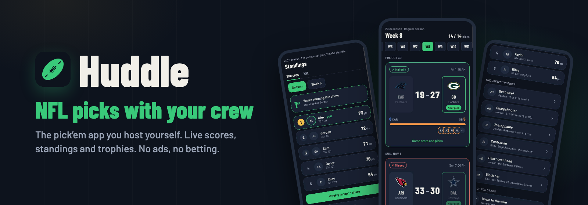

<p align="center">
  <a href="https://gwenoler.github.io/huddle/">
    
  </a>
</p>

<p align="center">
  <a href="https://github.com/gwenoleR/huddle/releases"></a>
  <a href="https://github.com/gwenoleR/huddle/actions/workflows/docker.yml"></a>
  <a href="https://github.com/gwenoleR/huddle/pkgs/container/huddle"></a>
  <a href="LICENSE"></a>
  
</p>

<h3 align="center">Pick every NFL game with your friends, on a server you own.</h3>

<p align="center">
  Live scores, standings that move during games, trophies and a weekly recap for the group chat.<br>
  One Docker container, no accounts to create, no ads, no betting.
</p>

<p align="center">
  <a href="https://gwenoler.github.io/huddle/"><b>Website</b></a> ·
  <a href="https://gwenoler.github.io/huddle/guide/"><b>Install in 5 minutes</b></a> ·
  <a href="https://gwenoler.github.io/huddle/#see-it-in-action">Screenshots &amp; video</a> ·
  <a href="https://github.com/gwenoleR/huddle/releases">Releases</a> ·
  <a href="CHANGELOG.md">Changelog</a> ·
  <a href="https://gwenoler.github.io/huddle/fr/">Français</a>
</p>

---

Huddle is a mobile web app (PWA) you install on your home screen and host yourself with Docker. One instance = one group.

- **Games** of the week with team logos, one tap to make a pick, and the group's split under each game.
- **Locking** at kickoff (server-side), **live scores**, points computed automatically.
- **Leaderboard** by season / week, **profile** week by week, **season recap** with trophies.
- **Season after season**: the new season takes over by itself on June 1st (once ESPN publishes the schedule, week 1 is already open for picks). Until then, the finished season stays on screen. Past seasons remain available: a « Saisons précédentes » link at the bottom of the leaderboard leads to their recap (final standings and trophies).
- **Notifications**: a reminder 1 h before a game you haven't picked, results once a week is over.

Scoring: 1 point per correct pick in the regular season, **2 points in the playoffs** (configurable, see [Settings](#settings)).

## Quick start

You need a machine that runs Docker (a home server, a NAS, a Raspberry Pi, a small VPS — amd64 or arm64) and a web address in HTTPS: phones need HTTPS to install the app and receive notifications.

1. **A folder with two files**:
   ```bash
   mkdir -p ~/huddle && cd ~/huddle
   curl -O https://raw.githubusercontent.com/gwenoleR/huddle/main/docker-compose.yml
   echo "PUBLIC_URL=https://huddle.example.com" > .env
   ```
   `PUBLIC_URL` is the address everyone will type on their phone. The other settings are optional (see [Settings](#settings) and [`.env.example`](.env.example)).
2. **Start it**:
   ```bash
   docker compose up -d
   ```
   The app listens on port 3000. On first start it downloads the 32 teams, their logos and the season's 272 games (about 30 s); the logs (`docker compose logs huddle`) then say there are no players yet.
3. **Put it behind HTTPS** so that `PUBLIC_URL` reaches port 3000: see [HTTPS](#https).
4. **Create the group**: the first person to open the address picks their first name and a 4-digit PIN, and becomes the admin. Do it right after the first start: until the group exists, anyone with the address could create it. The admin then adds the others from Profile › Administration; each player picks their name and **the first PIN they type becomes theirs**.
5. **Install the app** on each phone:
   - **iPhone** (Safari): Share › *Add to Home Screen*. Notifications only work once the app is opened from its icon (iOS 16.4 minimum).
   - **Android** (Chrome): ⋮ menu › *Install app*.
   - Then, in the profile, turn notifications on.

Already have picks from earlier weeks somewhere else? The admin can import them as CSV (see [Admin](#admin)).

### HTTPS

Pick whichever fits your setup:

- **Caddy** (simplest with a domain name and ports 80/443 open): [`examples/docker-compose.caddy.yml`](examples/docker-compose.caddy.yml) runs the app and Caddy, which gets the certificate by itself. Put `DOMAIN=huddle.example.com` in `.env` instead of `PUBLIC_URL`, then `docker compose -f docker-compose.caddy.yml up -d`.
- **Cloudflare Tunnel** (nothing to open on your router): in Zero Trust › Networks › Tunnels › your tunnel › *Public Hostname*, add your hostname → service `HTTP`, URL `<server-ip>:3000` (or `huddle:3000` if cloudflared runs on the same Docker network).
- **Your own reverse proxy** (Traefik, nginx, Nginx Proxy Manager…): forward the hostname to port 3000. The app trusts `X-Forwarded-*` headers, so the real client address is used for the login rate limit.
- **Just trying it on your LAN**: `PUBLIC_URL=http://192.168.1.10:3000` works for logging in and making picks in a browser, but phones won't install the app nor get notifications without HTTPS.

### Updating

```bash
docker compose pull && docker compose up -d
```

The database migrates by itself on start; a copy beforehand never hurts (stop the app first, so the copy is complete):
```bash
docker compose stop huddle && docker compose cp huddle:/data/huddle.db ./huddle-backup.db && docker compose start huddle
```

What changed in each version is in [`CHANGELOG.md`](CHANGELOG.md) (and on the GitHub releases page). Versions follow semver: a **major** version (2.0.0) may need something from you, and its changelog says exactly what; minor and patch versions never do. The app notices when the server is newer and offers to reload.

Image tags on `ghcr.io/gwenoler/huddle` (amd64 and arm64):

| Tag | What you get |
| --- | --- |
| `latest` | The last release (default in `docker-compose.yml`) |
| `1`, `1.0`, `1.0.0` | Pinned to a major, minor or exact version |
| `edge` | The tip of `main`, between releases (version shown as `1.0.0-edge.abc1234`) |
| `sha-abc1234` | One exact build, to roll back |

## Settings

All optional, in the `.env` next to `docker-compose.yml` (then `docker compose up -d`). `PUBLIC_URL` is the only required one.

| Variable | Default | Purpose |
| --- | --- | --- |
| `APP_NAME` | Huddle | App name: title, login screen, installed app |
| `APP_SHORT_NAME` | Huddle | Name under the home screen icon |
| `APP_LANG` | `fr` | Language of the app and notifications: `fr` (French) or `en` (English) |
| `POINTS_REGULAR` | 1 | Points for a correct pick in the regular season |
| `POINTS_PLAYOFFS` | 2 | Points for a correct pick in the playoffs (Wild Card to Super Bowl) |
| `TZ` | Europe/Paris | Time zone for times in notifications. In the app, everyone sees times in their phone's time zone |

Scoring applies to the whole season, games already played included: changing it mid-season recomputes the leaderboard. An app already open on a phone picks up a new name or language on its next launch.

### Translating the app

All texts live in `shared/i18n/<lang>/` (`fr/` and `en/`), one file per part of the app (games, leaderboard, profile, notifications…). For a new language, say German: copy `en/` to `de/`, translate, add it to `DICTIONARIES` in `shared/i18n/index.ts`, then set `APP_LANG=de`. Dates, times (12 or 24 h) and numbers follow the dictionary's `locale`. Texts with values are functions (plurals, names, numbers): translate the whole sentence. The typecheck rejects a translation that is missing a text.

## Admin

The group's creator is an admin and can make other players admins. Admins get an Administration page, reached from their profile:
- **Add a player**, with starting points if they join mid-season. Starting points only apply to the current season: everyone starts back at 0 the following season.
- For each player (tap their name): **rename**, **clear the PIN** (they pick a new one at their next login), **grant / revoke admin**, **delete** (their picks go with them). You can neither delete yourself nor revoke your own rights: there is always an admin left.
- **Import history**: weeks played elsewhere, as CSV. A header row `,Home,Away,Prono GW,Prono AU,…` (the first two letters of the first name, ignoring accents), then one row per game with the full team names (`Kansas City Chiefs`), `Week1` in the first column on the first game of each week, and an empty cell for a missing pick. The file is first checked in a dry run (how many picks, for whom), then imported on confirmation. It's all or nothing: on any error, nothing is written and every problem is listed. Starting points of the players in the file are reset to 0.

PIN security: 5 wrong attempts lock that name for 15 minutes, and 20 wrong attempts from the same connection lock it for an hour.

## Data

- Source: ESPN's public API (unofficial, free, no key). Everything goes through `server/espn.ts`; if ESPN changes its format, that's the only file to adapt. As a fallback, the `games.csv` file from [nflverse](https://github.com/nflverse/nfldata) has the same games along with the ESPN IDs.
- Tracked season: the current one based on the date (see above). To pin it (tests, demo), set `SEASON=2026`.
- Sync: full season once a day, current weeks every hour, **every 2 minutes during games**.
- SQLite database in the `huddle-data` Docker volume (`/data/huddle.db`; installs from before the rename keep `/data/prono.db`).
  Backup (with the app stopped, so the copy is complete):
  ```bash
  docker compose stop huddle && docker compose cp huddle:/data/huddle.db ./huddle-backup.db && docker compose start huddle
  ```

## Development

```bash
npm install
npm run dev
```

The UI runs on http://localhost:5173 and the API on port 3000. Other commands:

- `npm run build`: builds the UI and the server into `dist/`;
- `npm start`: runs the built version;
- `npm run typecheck`: checks types;
- `npm test`: runs the tests (`npm run test:watch` to rerun them on every change);
- `npm run icons`: regenerates the icons from `web/public/icon.svg`.

| Folder | Contents |
| --- | --- |
| `server/` | Fastify, SQLite (`node:sqlite`), ESPN sync, scoring, login, notifications |
| `server/routes/` | API routes, one file per domain (login, games, leaderboard, bonus, NFL, admin, notifications) |
| `server/schema.ts` | Database tables, as numbered migrations: to change the database, **append** a migration at the end |
| `shared/i18n/` | App and server texts, one dictionary per language (only `fr/` exists) |
| `shared/api.ts` | Shape of the API responses, shared by the server and the app |
| `web/src/ds/` | Design system tokens and components, one file per component with its CSS |
| `web/src/screens/` | The screens |
| `web/src/sw.ts` | Service worker: offline cache and notifications |
| `tests/` | Vitest tests: in-memory SQLite database, ESPN responses recorded in `tests/fixtures/espn` |
| `scripts/` | Release helpers: changelog notes, sample database snapshot |
| `examples/` | Docker Compose variants (Caddy for HTTPS) |

### Tests

Every new feature or fix comes with its tests. They never touch `data/` and never call ESPN or the notification servers: each test file has its own in-memory database (see `tests/server/helpers.ts` to create players, games and picks). In CI, types and tests run before the Docker image is built: if either fails, nothing is published.

To refresh a recorded ESPN response, download it, then keep only the fields read by `server/espn.ts`.

`tests/server/upgrade.test.ts` opens the sample database left by every release (`tests/fixtures/db/`) with the current code: migrations must run and the standings must stay the same, so an update never breaks someone's instance.

### Releasing

1. In `CHANGELOG.md`, move what's under *Unreleased* to a new `## [x.y.z] - date` section (and say what hosts must do, for a major version).
2. `npm version x.y.z --no-git-tag-version` to bump `package.json`.
3. `npm run db:snapshot -- x.y.z` to record this release's sample database for the upgrade test.
4. Commit, then tag and push: `git tag vx.y.z && git push && git push origin vx.y.z`.

CI checks that the tag matches `package.json` and has a changelog section, runs the tests, publishes the image for amd64 and arm64 with the version tags and `latest`, then creates the GitHub release with that section as notes.

## Disclaimer

Huddle is an independent, non-commercial hobby project. It is not affiliated with, endorsed by or
sponsored by the National Football League, its teams, or ESPN. NFL and team names, logos and marks
belong to their owners and are shown only to identify the games.

Game data comes from ESPN's **public but unofficial** API: it has no documented terms for this use,
can change or disappear at any time, and the app would then stop syncing until `server/espn.ts` is
adapted. Use it for your group of friends, not for a commercial service. No betting: picks have no
stake and no prize.

## License

[MIT](LICENSE)

